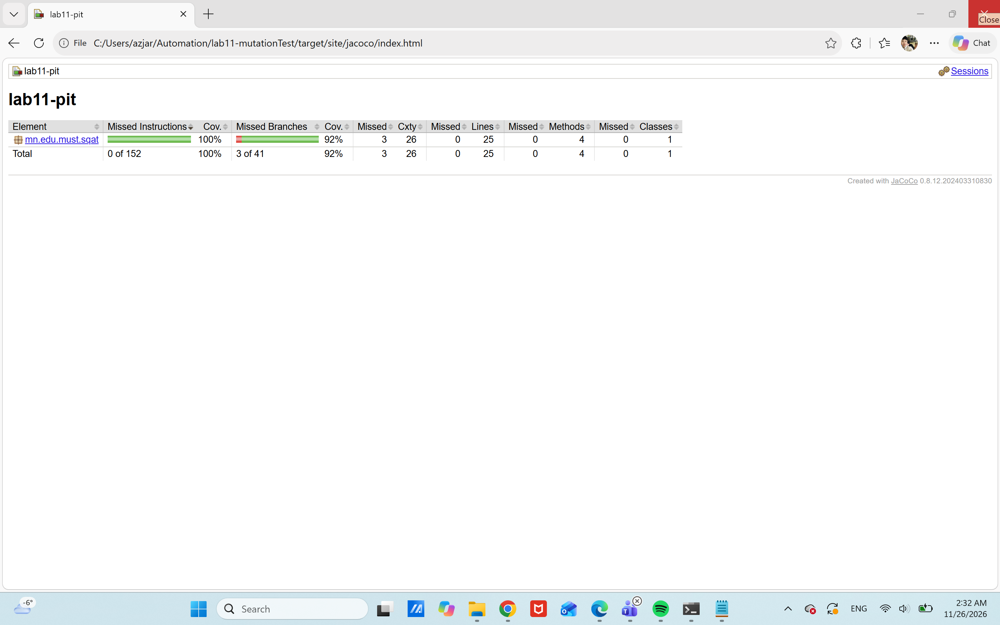
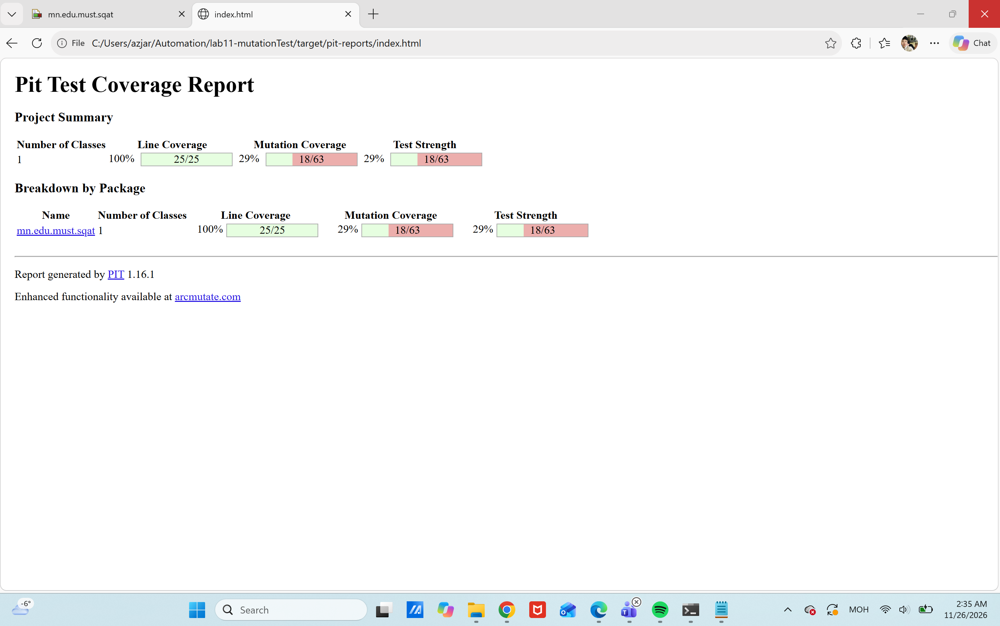
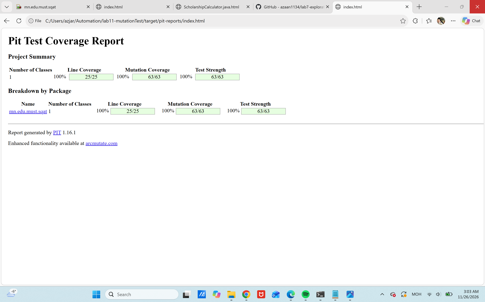

# Лаборатори №11: Mutation testing — PIT

**Овог нэр:** С. Азжаргад
**Оюутны код:** B232270052

### Орчин

```
> java -version
openjdk version "17.0.20.1" 2026-08-18
OpenJDK Runtime Environment Temurin-17.0.20.1+1 (build 17.0.20.1+1)
OpenJDK 64-Bit Server VM Temurin-17.0.20.1+1 (build 17.0.20.1+1, mixed mode, sharing)
```

```
> mvn -version
Apache Maven 3.9.16 (2bdd9fddda4b155ebf8000e807eb73fd829a51d5)
Maven home: C:\Program Files\apache-maven-3.9.16
Java version: 17.0.20.1, vendor: Eclipse Adoptium, runtime: C:\Program Files\Eclipse Adoptium\jdk-17.0.20.101-hotspot
Default locale: en_US, platform encoding: Cp1252
OS name: "windows 11", version: "10.0", arch: "amd64", family: "windows"
```

---

## 1. Эхний хэмжилт (Starter)

### JaCoCo



- Line coverage: **100% (25/25)**
- Branch coverage: **92% (38/41)**
- Түүхий гаралт: [`results/jacoco-start.csv`](results/jacoco-start.csv), [`results/mvn-verify-start.txt`](results/mvn-verify-start.txt)

### PIT



[`results/pit-start.txt`](results/pit-start.txt)-ээс:

```
>> Line Coverage (for mutated classes only): 25/25 (100%)
>> Generated 63 mutations Killed 18 (29%)
>> Mutations with no coverage 0. Test strength 29%
```

### Ажиглалт

JaCoCo кодын бүх мөрийг (25/25) тестээр ажилласан гэж харуулж байгаа ч PIT-ийн 63 мутантаас ердөө 18-ыг нь (29%) тестүүд барьсан. Тестүүд кодыг *ажиллуулж* байгаа боловч гарсан утгыг нь *шалгахгүй* байгаа нь үүний шалтгаан: `assertNotNull`, `assertTrue(0..100)` гэх мэт сул assertion нь буруу утга буцсан ч давж гардаг. Тиймээс хамралт 100% байх нь тест алдаа барьж чадна гэсэн үг биш.

---

## 2. Хэсэг A — Амьд мутантуудын ангилал

Эх сурвалж: `target/pit-reports/mn.edu.must.sqat/ScholarshipCalculator.java.html`. Starter дээр 63 мутантаас **45 нь SURVIVED** болсон. 24-р мөрний 1 мутант RUN_ERROR гарсан бөгөөд PIT үүнийг барьсанд (killed) тооцдог.

| Мөр | Мутаци (PIT-ийн тайлбар) | Тоо | Ангилал | Үндэслэл | Арга хэмжээ |
|---|---|---|---|---|---|
| 20 | changed conditional boundary (`score < 0` → `<= 0`, `score > 100` → `>= 100`) | 2 | Тест дутуу | 0 ба 100 нь хүчинтэй оноо мөртлөө мутант exception шиддэг тул зан төлөв өөрчлөгддөг. | `letterGrade(0)="F"`, `letterGrade(100)="A"`, `-0.01`, `100.01` тест |
| 23–26 | changed conditional boundary (`>=` → `>`) | 4 | Тест дутуу | 90/80/70/60 яг заагийн оноонд өөр үсгэн дүн буцаадаг, гэхдээ тест заагийн утгыг шалгадаггүй. | 90/89.99, 80/79.99, 70/69.99, 60/59.99 зааг тест |
| 23–26 | removed conditional — replaced comparison check with true / false | 7 | Тест дутуу | Нөхцөлийг үргэлж true эсвэл false болгоход өөр үсэг буцдаг ч `assertNotNull` ялгаж чаддаггүй. | Яг утгын `assertEquals("A", …)` |
| 23–27 | replaced return value with "" | 5 | Тест дутуу | Хоосон мөр буцаах нь буруу ч `null` биш тул `assertNotNull` давж гардаг. | Яг утгын `assertEquals` |
| 36 | Changed switch default to be first case | 1 | Тест дутуу | F дүнд 0-ийн оронд 4 нэмэгдэх ч голч 0–4 мужид багтсаар байдаг. | `gpa({30}) = 0.0` яг утга |
| 38, 40 | Replaced double addition with subtraction | 2 | Тест дутуу | B, D дүнгийн оноо хасагдаж голч өөрчлөгддөг ч үр дүн нь 0–4 мужид багтдаг. | `gpa({95,85}) = 3.5`, `gpa({75,65}) = 1.5` |
| 44 | replaced double return with 0.0d | 1 | Тест дутуу | 0.0 нь мужид багтдаг тул `assertTrue(0..4)` давж гардаг. | Голчийн яг утгыг шалгах |
| 48 | changed conditional boundary (`gpa < 0` → `<= 0`, `credits < 0` → `<= 0`) | 2 | Тест дутуу | gpa=0 эсвэл credits=0 хүчинтэй оролт мөртлөө мутант exception шиддэг. | `scholarship(0.0, 0) = 0`, `scholarship(3.0, 0) = 50` |
| 48 | removed conditional — replaced comparison check with true | 1 | Тест дутуу | Сөрөг gpa-гийн тест байхгүй тул оролтын шалгалтын нэг хэсгийг өөрчлөхөд ялгагдахгүй. | `scholarship(-0.01, …)`, `scholarship(4.01, …)` throw тест |
| 51 | removed conditional — replaced equality check with true / false | 2 | Тест дутуу | Зөрчлийн шалгалт алга болох юм уу үргэлж 0 буцаах болдог ч 0 нь 0–100 мужид багтдаг. | Зөрчилтэй үед `0`, зөрчилгүй үед `100` гэж яг утгаар шалгах |
| 52 | boundary ×2, replaced comparison true/false ×4, replaced int return with 0 | 7 | Тест дутуу | 3.8/15 заагт олгох хувь өөрчлөгддөг ч тест зөвхөн 0–100 мужийг шалгадаг. | 3.8/15 → 100, 3.79/15 → 70, 3.8/14 → 70 |
| 53 | boundary ×2, replaced comparison true/false ×4, replaced int return with 0 | 7 | Тест дутуу | 3.4/12 заагт хувь өөрчлөгддөг. | 3.4/12 → 70, 3.39/12 → 50, 3.4/11 → 50 |
| 54 | boundary, replaced comparison true/false ×2, replaced int return with 0 | 4 | Тест дутуу | 3.0 заагт 50 ба 0-ийн хооронд солигддог. | 3.0 → 50, 2.99 → 0 |
| | **Нийт** | **45** | | | |

**Дүгнэлт:** Амьд үлдсэн 45 мутант бүгд програмын бодит зан төлөвийг өөрчилдөг тул **тест дутуу** ангилалд орсон, equivalent мутант олдсонгүй. Эдгээрээс "replaced return value" болон "removed conditional" мутантууд assertion сул байгааг, "changed conditional boundary" мутантууд зааг утгын тест дутуу байгааг илтгэнэ.

---

## 3. Хэсэг B — Тестүүдийг хүчтэй болгох

### B1 — Assertion-уудыг яг утгатай болгосон

Оролтуудыг starter-тэй яг ижил үлдээгээд, зөвхөн сул шалгалтуудыг (`assertNotNull`, `assertTrue(муж)`) `assertEquals`-ээр сольсон. Жишээ нь `letterGrade(95)` яг `"A"`, `gpa({95,85})` яг `3.5`, `scholarship(3.9,16,false)` яг `100` буцаахыг шалгана.

[`results/pit-B1.txt`](results/pit-B1.txt)-ээс:

```
>> Generated 63 mutations Killed 45 (71%)
>> Mutations with no coverage 0. Test strength 71%
```

B1-ээр "replaced return value", "replaced double addition with subtraction", "switch default" болон зарим "removed conditional" мутантууд үхсэн. Харин "changed conditional boundary" мутантууд амьд хэвээр үлдсэн, учир нь тест заагийн утгуудыг (90, 3.8, 15 г.м.) огт ашигладаггүй.

### B2 — Зааг утгын тестүүд нэмсэн

- `letterGrade`: 100, 90/89.99, 80/79.99, 70/69.99, 60/59.99, 0 (`@ParameterizedTest`); хүчингүй утга −0.01, 100.01
- `gpa`: A/B/C/D/F үсгэн дүн тус бүрийг дангаар нь, 5 үсэг холимог, заагийн оноонууд, хүчингүй оноотой массив
- `scholarship`: 3.8/15, 3.79/15, 3.8/14, 3.4/12, 3.39/12, 3.4/11, 3.0/0, 2.99/20; оролтын хязгаар (gpa 0 ба 4, credits 0); зөрчилтэй тохиолдлууд; хүчингүй утга −0.01, 4.01

[`results/pit-B2.txt`](results/pit-B2.txt)-ээс:

```
>> Generated 63 mutations Killed 63 (100%)
>> Mutations with no coverage 0. Test strength 100%
```

### Хэмжилтийн явц

| Хэмжилт | Файл | Killed / Generated | Mutation Coverage | Test Strength |
|---|---|---|---|---|
| Эхлэл (Starter) | [`results/pit-start.txt`](results/pit-start.txt) | 18 / 63 | 29% | 29% |
| B1-ийн дараа | [`results/pit-B1.txt`](results/pit-B1.txt) | 45 / 63 | 71% | 71% |
| B2-ийн дараа (эцсийн) | [`results/pit-B2.txt`](results/pit-B2.txt) | 63 / 63 | 100% | 100% |

Line coverage гурван хэмжилтийн аль алинд нь 100% (25/25) байсан ч mutation score 29% → 71% → 100% болж өссөн. Equivalent мутант байгаагүй тул Test Strength нь Mutation Coverage-тэй тэнцүү гарсан.

Эцсийн PIT тайлан:



---

## 4. Хэсэг C — Гар мутаци (PIT-гүйгээр)

### Гар мутант: `gpa >= 3.8` → `gpa > 3.8`

`scholarship()`-ийн 52-р мөрийг гараар өөрчлөөд `mvn test` ажиллуулсан. Нотолгоо: [`results/mvn-test-manual-mutant.txt`](results/mvn-test-manual-mutant.txt)

```
[ERROR] Tests run: 35, Failures: 1, Errors: 0, Skipped: 0
[ERROR]   ScholarshipCalculatorTest.scholarship_boundaries:137 expected: <100> but was: <70>
```

- **Унасан тест:** `scholarship_boundaries(double, int, int)[1]`, өөрөөр хэлбэл B2-д нэмсэн `scholarship(3.8, 15, false) = 100` зааг тест.
- **Шалтгаан:** мутацитай кодод gpa яг 3.8 үед `3.8 > 3.8` нөхцөл false болдог тул 100-ын оронд дараагийн дүрэм ажиллаж 70 буцаадаг.
- Starter-ийн сул тест энэ мутантыг барьж чадахгүй байсан, учир нь тэнд 3.8 гэсэн утга ашиглаагүй бөгөөд `assertTrue(0..100)` шалгалт 70-ыг ч давуулдаг.
- Туршилтын дараа `git restore src/main`-ээр кодыг буцаасан тул мутацитай код commit хийгдээгүй.

### Өөрийн зохиосон equivalent мутант

`scholarship()`-ийн 52-р мөрийн `&&`-ийн хоёр хэсгийн байрыг сольсон:

```java
// Эх:      if (gpa >= 3.8 && credits >= 15) return 100;
// Мутант:  if (credits >= 15 && gpa >= 3.8) return 100;
```

Хоёр нөхцөл хоёулаа гаж нөлөөгүй энгийн харьцуулалт тул `&&`-ийн дарааллыг солиход аль ч оролтод үр дүн нь яг адилхан гарна. Програмын ажиглагдах зан төлөв огт өөрчлөгдөхгүй учраас ямар ч тест энэ мутантыг "алж" чадахгүй.

---

## 5. Дүгнэлт

Code coverage нь тест ажиллах үед кодын аль мөр, аль салаа *ажилласныг* хэмждэг бол mutation score нь тест кодын алдааг *барьж чадах эсэхийг* хэмждэг. Энэ лабын starter тест Line coverage 100% (25/25) өгч байсан ч mutation score ердөө 29% байсан. Учир нь `assertNotNull`, `assertTrue(муж)` гэх мэт сул assertion нь буруу утга буцаасан ч давж гардаг. Assertion-уудыг яг утгатай болгоход (B1) score 71% болж, "replaced return value" болон math мутантууд үхсэн. Зааг утгын тестүүд нэмэхэд (B2) "conditional boundary" болон "removed conditional" мутантууд үхэж score 100% хүрсэн. Энэ бүх хугацаанд line coverage 100% хэвээр байсан нь хамралт тестийн чанарыг хэмждэггүйг тод харуулж байна. AI-аар бичүүлсэн тест ихэвчлэн бүх мөрийг дайрдаг тул хамралт өндөр харагддаг ч assertion нь сул эсвэл зааг утгыг алгассан байх магадлалтай. Тиймээс AI-ийн бичсэн тестийг mutation score-оор шалгаж, амьд үлдсэн мутант бүрийг тест дутуу эсвэл equivalent гэж ангилсны дараа л итгэж ашиглах хэрэгтэй.
